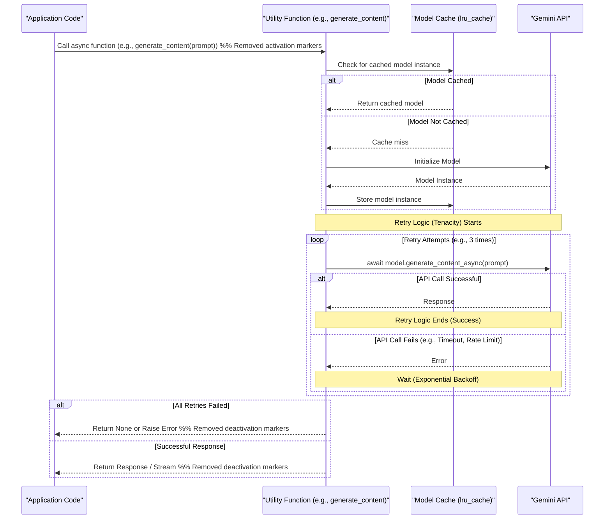
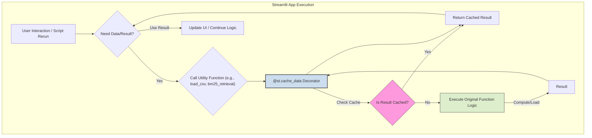

# IntelliForge: Applied GenAI Playbook - Project Overview

- **Version:** 1.2 (Performance Enhancements)
- **GitHub Repository:** [Mathews-Tom/IntelliForge-Applied-GenAI-Playbook](https://github.com/Mathews-Tom/IntelliForge-Applied-GenAI-Playbook)
- **License:** [MIT License](https://opensource.org/licenses/MIT)

## 1. Introduction

Welcome to IntelliForge, a curated collection of practical demonstration applications designed to showcase the power and versatility of Google's **Gemini 2.5 Pro** large language model. This repository serves as a hands-on playbook for developers, researchers, and enthusiasts interested in exploring applied Generative AI (GenAI) and Agentic AI concepts.

The primary goal of IntelliForge is to move beyond theoretical discussions and provide concrete, runnable examples of how state-of-the-art AI can be integrated into functional applications across various domains, including data analysis, financial insights, knowledge management, and **advanced information retrieval incorporating both static documents and dynamic web content**. This version now includes **eleven** distinct applications and incorporates significant performance enhancements in the core libraries.

## 2. Core Concepts Demonstrated

IntelliForge focuses particularly on illustrating sophisticated **Retrieval-Augmented Generation (RAG)** techniques, alongside other AI patterns:

- **Standard RAG:** Basic retrieval from a knowledge base to ground LLM responses (ContextQuest, GraphQuery).
- **Hybrid Retrieval:** Combining keyword (BM25) and semantic (vector) search for improved relevance, using Reciprocal Rank Fusion (RRF) for result combination (ContextQuest).
- **Graph RAG:** Using knowledge graphs (NetworkX) for structured information retrieval (GraphQuery).
- **Agentic Behavior:** Employing LLMs to orchestrate tasks and use external tools (FiscalAgent, ToolAugmentedRAG, CompetitiveAnalysisAgent).
- **Self-Correction/Reflection (Enhanced RAG):** Systems that evaluate and refine their own retrieval/generation process (ReflectiveRAG).
- **Adaptive/Conditional RAG:** Dynamically adjusting the retrieval strategy based on query analysis (AdaptiveQueryRAG).
- **Multi-Source Synthesis (Enhanced RAG):** Handling and synthesizing information from multiple, potentially conflicting sources (MultiPerspectiveSynth).
- **Tool Augmentation (Agentic RAG):** Integrating real-time API data into the RAG workflow (ToolAugmentedRAG).
- **Dynamic Web RAG:** Building knowledge bases on-the-fly from dynamically crawled web content using **`crawl4ai`** (WebQuestRAG, CompetitiveAnalysisAgent, ResearchAssistantAgent, enhanced ContextQuest).
- **Targeted Web Crawling:** Focused information gathering from specific websites or topics using **`crawl4ai`** (CompetitiveAnalysisAgent, ResearchAssistantAgent).
- **Natural Language Interfaces:** Using Streamlit to create intuitive conversational interfaces for complex backend processes.
- **Performance Optimization:** Incorporating asynchronous operations, caching, retries, and batching for improved efficiency and responsiveness (Core library).

## 3. Overall System Architecture

IntelliForge employs a modular architecture where individual applications reside in the `apps/` directory. These applications operate independently but leverage shared components located in the `core/` directory, primarily for Gemini API interaction and common utility functions. The recent addition of web crawling capabilities utilizes the `crawl4ai` library, integrated via a shared utility (`core/utils/web_crawler.py`). **Core components have been enhanced for performance.**

```bash
IntelliForge-Applied-GenAI-Playbook/
│
├── apps/                   # Directory for individual applications
│   │
│   ├── context_quest/      # ContextQuest: Hybrid Retrieval with optional web source
│   │   ├── src/
│   │   ├── data/
│   │   └── README.md
│   ├── fiscal_agent/       # FiscalAgent: Financial Insights
│   │   ├── src/
│   │   ├── data/
│   │   └── README.md
│   ├── graph_query/        # GraphQuery: Knowledge Navigator
│   │   ├── src/
│   │   ├── data/
│   │   └── README.md
│   ├── insight_agent/      # InsightAgent: Data Analysis
│   │   ├── src/
│   │   ├── data/
│   │   └── README.md
│   ├── reflective_rag/     # ReflectiveRAG: Self-Correcting Retrieval
│   │   ├── src/
│   │   ├── data/
│   │   └── README.md
│   ├── adaptive_query_rag/ # AdaptiveQueryRAG: Contextual Strategy Selection
│   │   ├── src/
│   │   ├── data/
│   │   └── README.md
│   ├── multi_perspective_synth/ # MultiPerspectiveSynth: Synthesizing Diverse Sources
│   │   ├── src/
│   │   ├── data/
│   │   └── README.md
│   ├── tool_augmented_rag/ # ToolAugmentedRAG: Retrieval + Live Data Integration
│   │   ├── src/
│   │   ├── data/
│   │   └── README.md
│   ├── web_quest_rag/      # WebQuestRAG: Dynamic Web RAG Agent
│   │   ├── src/
│   │   ├── data/ (Optional: for saving crawl results?)
│   │   └── README.md
│   │
│   ├── competitive_analysis_agent/ # CompetitiveAnalysisAgent: Web Competitor Intelligence
│   │   ├── src/
│   │   ├── data/ (Optional: for saving crawl results?)
│   │   └── README.md
│   │
│   └── research_assistant_agent/ # ResearchAssistantAgent: Web Research Helper
│       ├── src/
│       ├── data/ (Optional: for saving crawl results?)
│       └── README.md
│
├── core/                   # Shared core components (PERFORMANCE ENHANCED)
│   ├── llm/                # LLM integration logic
│   │   └── gemini_utils.py # Gemini API utilities (Async, Cached, Retries, Streaming)
│   └── utils/              # Shared utility functions
│       ├── __init__.py     # Package initialization
│       ├── data_helpers.py # Data loading and processing (Cached)
│       ├── ui_helpers.py   # Streamlit UI components
│       ├── file_io.py      # File handling operations
│       ├── retrieval_utils.py # Retrieval & embedding (Async, Cached, Batched, RRF)
│       ├── evaluation.py   # Evaluation metrics (Async, Cached)
│       └── web_crawler.py  # Web crawling using crawl4ai (Cached)
│
├── docs/                   # Documentation
│   ├── apps/               # Detailed app docs
│   │   └── ...             # <<< Files for each app
│   ├── figures/            # Diagrams (if any)
│   ├── architecture.md     # (Legacy/Source) Architecture notes
│   ├── enhancement_plan.md # NEW: Details on performance enhancements
│   └── overview.md         # <<< This file
│
├── .env.example            # Example environment file
├── .gitignore              # Git ignore file
├── LICENSE                 # Repository license file (Should contain MIT License text)
└── README.md               # Main repository README (links here and to apps)

```

*(Note: Corrected the `docs/` structure and added enhancement plan)*

## 4. Core Components

### 4.1. Gemini Integration (`core/llm/gemini_utils.py`)

This module is the heart of the LLM interaction layer. It provides a standardized and reusable way for all applications to interact with the Google Gemini API.

- **API Key Configuration:** Securely loads the `GOOGLE_API_KEY` using `python-dotenv`.
- **Model Selection:** Uses a Python `Enum` (`GeminiModelType`) to allow selection of specific Gemini models (defaulting to **Gemini 2.5 Pro**).
- **Content Generation Function (`generate_content`):**
  - **Asynchronous:** Operates using `async`/`await` for non-blocking API calls.
  - **Model Caching:** Caches initialized `GenerativeModel` instances (`@functools.lru_cache`) to avoid redundant setup.
  - **Retries:** Implements automatic retries with exponential backoff (`tenacity`) for resilience against transient API errors.
  - **Streaming Support:** Optionally returns an `AsyncIterator` for streaming responses, improving perceived UI responsiveness.
- **Type Hinting:** Ensures code quality and developer experience.

### 4.2. Shared Utilities (`core/utils/`)

This package encapsulates common functionalities reused across multiple applications, promoting code reuse and consistency.

- **`data_helpers.py`:** Functions for loading documents (CSV, TXT), text splitting/chunking, cleaning text. **Loading functions are cached (`@st.cache_data`)** for faster re-runs in Streamlit.
- **`ui_helpers.py`:** Reusable Streamlit components.
- **`file_io.py`:** Generic functions for reading/writing common file formats.
- **`retrieval_utils.py`:** Core logic for retrieval and ranking:
  - **Embedding Generation (`get_embeddings`):** Asynchronous (`async def`), uses batching for efficiency, implements retries (`tenacity`), and supports caching.
  - **Keyword Search (`bm25_retrieval`):** Cached (`@st.cache_data`) for performance when document sets are static within a session.
  - **Embedding Search (`embedding_retrieval`):** Asynchronous (`async def`), leverages the async `get_embeddings`.
  - **Hybrid Retrieval (`hybrid_retrieval`):** Asynchronous (`async def`), combines BM25 and embedding results using **Reciprocal Rank Fusion (RRF)** for improved ranking.
  - **Reranking (`rerank_documents`, `gemini_rerank`):** Asynchronous (`async def`), leveraging the async `generate_content`.
- **`evaluation.py`:** Functions for evaluating RAG performance:
  - **LLM-based Evaluations:** Functions like `evaluate_retrieval_relevance`, `evaluate_answer_faithfulness`, and `evaluate_answer_quality` are now **asynchronous (`async def`)** and **cached (`@st.cache_data`)**.
- **`web_crawler.py`:** Provides functions leveraging `crawl4ai`:
  - **Crawling Functions (`crawl_url`, `crawl_multiple_urls`, `crawl_topic`):** Cached (`@st.cache_data`) to avoid re-crawling identical requests within a session.
  - **Loading Function (`load_crawled_content`):** Cached (`@st.cache_data`) for faster loading of previously saved crawl results.

### 4.3. Performance Enhancements Summary

Significant effort has been invested in optimizing the core components for better performance and efficiency:

- **Asynchronous Operations:** Key I/O-bound operations, especially interactions with the Gemini API (generation, embeddings) and potentially long-running tasks like reranking or evaluation, have been converted to use Python's `async`/`await` syntax. This prevents blocking and allows applications (particularly Streamlit apps) to remain responsive during these operations.
- **Caching:**
  - **Streamlit Caching (`@st.cache_data`):** Applied to functions that load data from files (CSVs, text files, crawled content), perform potentially expensive computations (BM25 scoring), or run LLM-based evaluations. This drastically speeds up re-runs within a Streamlit session when inputs haven't changed.
  - **Model Instance Caching (`@functools.lru_cache`):** Used in `gemini_utils.py` to cache initialized Gemini model instances, avoiding redundant setup costs.
  - **Embedding Caching:** The `get_embeddings` function accepts an optional dictionary cache to store and retrieve computed embeddings, minimizing redundant API calls.
- **API Call Resilience (`tenacity`):** Both content generation and embedding generation API calls now automatically retry on failure using exponential backoff, making them more robust against transient network issues or rate limits.
- **Batching:** Embedding generation (`get_embeddings`) processes texts in batches, significantly improving throughput compared to embedding texts one by one.
- **Streaming:** Content generation (`generate_content`) supports optional streaming, allowing applications to display results incrementally as they are generated by the LLM.
- **Hybrid Retrieval (RRF):** Switched from simple weighted combination to Reciprocal Rank Fusion for potentially more robust hybrid ranking.

## Diagram: Enhanced API Call Flow (Async + Cache + Retry)



## Diagram: Streamlit Caching Layer



## 5. Design Principles

The development of IntelliForge adheres to the following principles:

1. **Modularity:** Each application in `apps/` is self-contained.
2. **Reusability:** Common functionalities are centralized in `core/`.
3. **Consistency:** Similar project structures and UI patterns.
4. **Extensibility:** Easy to add new applications.
5. **Clarity & Documentation:** Emphasis on clear code and documentation.
6. **Focus on Concepts:** Illustrate specific AI techniques.
7. **Performance:** Core utilities optimized for speed and efficiency (async, caching, etc.).

## 6. Technology Stack (Overall)

- **Primary Language:** Python (3.8+)
- **Core AI Model:** Google Gemini 2.5 Pro
- **AI SDK:** `google-generativeai`
- **Web UI Framework:** Streamlit
- **Web Crawling:** `crawl4ai`
- **Data Handling:** Pandas, NumPy
- **Configuration:** `python-dotenv`
- **Keyword Search:** `rank_bm25`
- **Vector Search:** (Example: `chromadb-client`)
- **PDF Processing:** `PyPDF2`
- **Graph Handling:** `NetworkX`
- **Visualization:** Plotly
- **Financial Data:** `yfinance`
- **API Retries:** `tenacity`

*(Refer to individual application documentation for specifics)*

## 7. Installation and Setup

Please refer to the main [README.md](../README.md#installation) for the general steps to clone the repository and set up your Google API Key via the `.env` file. Ensure core dependencies like `tenacity` are installed (they should be included in relevant `requirements.txt` files or the root one).

Detailed installation steps, including specific Python dependencies (`requirements.txt`) and environment setup for each application, can be found in the documentation for the respective application within the `docs/apps/` directory.

## 8. Security Considerations

- **API Keys:** Use `.env` file. Ensure `.env` is in `.gitignore`.
- **Data Handling:** Primarily local processing. Be mindful of privacy.
- **Web Crawling Ethics:** Respect `robots.txt` and terms of service.
- **Dependencies:** Keep up-to-date. Use virtual environments. Note `tenacity` dependency.
- **LLM Safety:** Rely on Google's built-in safety settings.

## 9. Future Enhancements (Potential Roadmap)

- **Application-Level Async:** Refactor Streamlit apps to fully leverage the async core utilities (e.g., using `asyncio.gather` for concurrent operations).
- **Containerization:** Provide Dockerfiles.
- **Testing Framework:** Implement unit/integration tests.
- **API Layer:** Expose functionality via REST APIs (FastAPI).
- **Monitoring/Logging:** Add more structured logging.
- **Deployment Examples:** Guides for cloud deployment.
- **Advanced Error Handling:** More robust error handling.
- **User Authentication:** Options for user accounts.
- **Enhanced Crawler Configuration:** More UI options for `crawl4ai`.
- **Hybrid Dynamic/Static RAG:** Sophisticated blending strategies.
- **Crawler State Management:** Save/resume large crawls.
- **Vector Store Optimization:** Deeper integration and optimization of vector stores like ChromaDB (e.g., using `@st.cache_resource` for connections).

## 10. Contributing

Contributions are highly encouraged! Please refer to the main [README.md](../README.md#contributing) for basic guidelines. Consider opening an issue first to discuss proposed changes or features.
